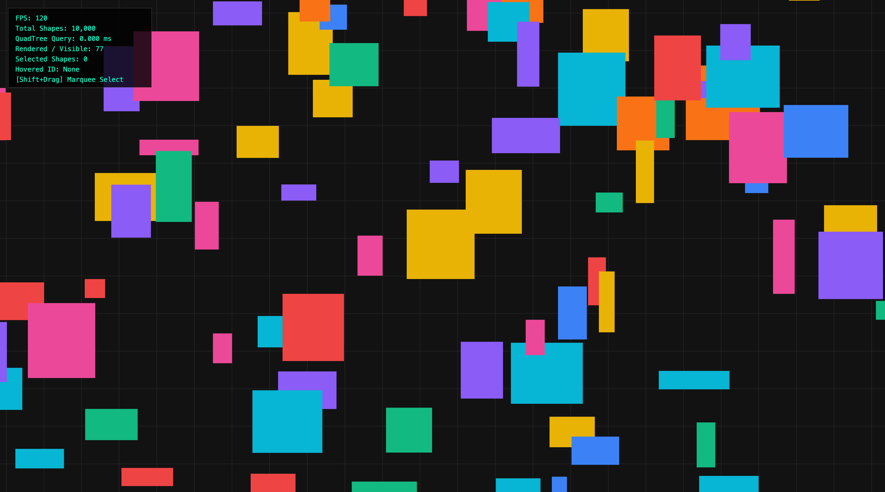
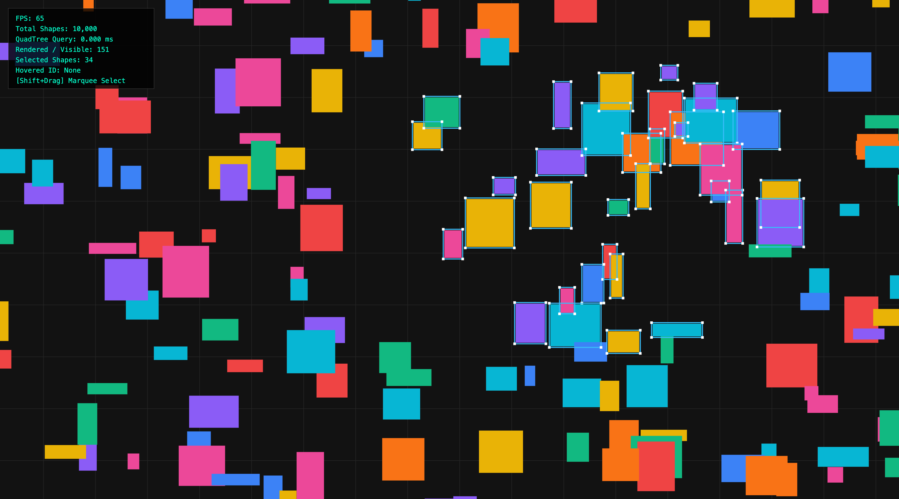

# Infinite Canvas

在 10,000 个矩形之间平移、缩放和框选，观察坐标变换、四叉树空间索引与视口裁剪。
由 [infinite-canvas-core](https://github.com/ieuforu/infinite-canvas-core) 迁入，保留原提交历史。

## 运行

在仓库根目录执行：

```sh
pnpm install --frozen-lockfile
pnpm dev:canvas
# 或 pnpm --filter infinite-canvas-core dev
pnpm check
pnpm build:site
```

组合站点的路径为 `/infinite-canvas/`。独立开发服务器只提供当前实验，跨实验导航需组合部署。

## 操作

| 操作           | 输入                                                          |
| -------------- | ------------------------------------------------------------- |
| 平移           | 拖动空白处；中键可在任意位置拖动                              |
| 缩放           | 画布内滚轮，锚定指针；工具栏 +/− 锚定画布中心                 |
| 单选与移动     | 点击图形后拖动                                                |
| 框选与批量移动 | Shift + 拖动框选，再拖动其中任意图形                          |
| 空间分区       | 工具栏「四叉树分区」；聚焦画布时按 D                          |
| 键盘浏览       | 聚焦画布后用方向键平移、+/− 缩放、Home 重置视角、Esc 清除选择 |

画布尺寸由容器决定，指针坐标先减去画布在页面中的偏移，再转换为世界坐标。
指针捕获维持画布外的拖动；抬起、取消、失去捕获或焦点时结束手势。
滚轮和画布快捷键只在画布内生效，侧边导航、页面滚动和按钮不受影响。
触屏支持单指操作；尚未实现多指缩放或屏幕阅读器逐图形操作。

## 观察与限制

- **坐标变换**：世界坐标为 `(屏幕坐标 - 视口偏移) / 缩放比例`，缩放范围为 0.02–30。
- **空间查询**：递归跳过不相交分区；跨分区矩形通过查询序号去重。范围查询的耗时取决于分布、树深、重叠与返回量，不保证统一的 O(log N)。
- **场景边界**：视口可继续漫游，但索引和图形活动范围为 `[-6000, 6000] × [-6000, 6000]`。批量拖动使用共同的受限位移，保持相对位置并防止图形移出索引后消失。
- **按需绘制**：交互标记下一帧需要重绘；静止时不持续刷新，因此不显示基于绘制次数计算的 FPS，也不承诺固定帧率。
- **耗时**：范围查询为一次 `queryRange` 的 JavaScript 耗时；绘制调用耗时包含该次查询和同步 Canvas 调用，不包含完整的 GPU 工作、合成与屏幕呈现。开启分区或选中大量图形会增加绘制工作。
- **内存**：可见对象数组在帧间复用，查询序号避免另建去重 Set；交互、树分裂和绘制仍会分配对象，不宣称整体零 GC。
- **实验范围**：这是浏览器交互实验，尚未提供独立库 API、持久化、旋转、撤销或多人协作。初始场景随机生成，单次耗时不作为跨实现的性能结论。

## 源码与验证

- `src/main.ts`：容器尺寸、输入、渲染、选择与观察值。
- `src/viewport.ts`：坐标映射、锚点缩放、框选矩形与整组边界约束。
- `src/quadtree.ts`：索引插入、去重查询、命中测试、删除与分区可视化。
- `tests/infinite-canvas.test.mjs`（仓库根目录）：以线性扫描核对范围查询，覆盖跨区去重、移动重索引、场景边界、缩放锚点和反向框选。
- `tests/infinite-canvas-interaction.test.mjs`：运行实际输入控制代码，用可控画布和事件替身检查页面偏移、画布外输入、指针取消、容器缩放与 HiDPI 尺寸。

Node.js 测试验证算法行为，不模拟浏览器绘制或代表真实性能测量。浏览器检查应覆盖容器缩放、页面滚动后指针定位、框选、移出画布、导航与移动端布局。

## 原始预览

以下截图来自迁入前的独立演示，保留用于对照；当前页面使用 Frontend Labs 的统一导航和控制栏。

| 画布与框选                                       | 四叉树分区                                         |
| ------------------------------------------------ | -------------------------------------------------- |
|  |  |

## License

沿用原仓库 README 的 MIT 声明。
